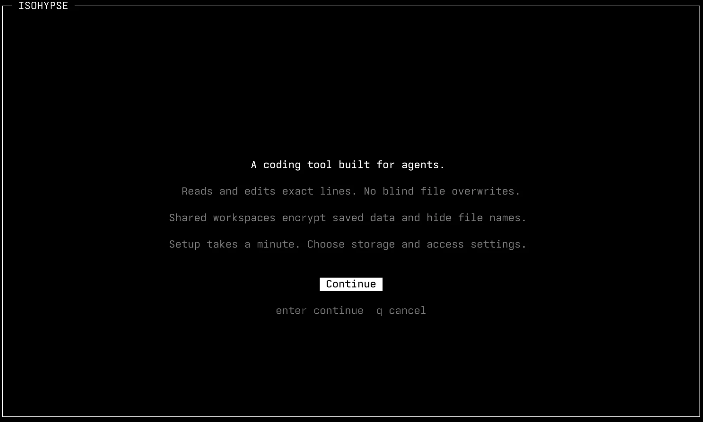
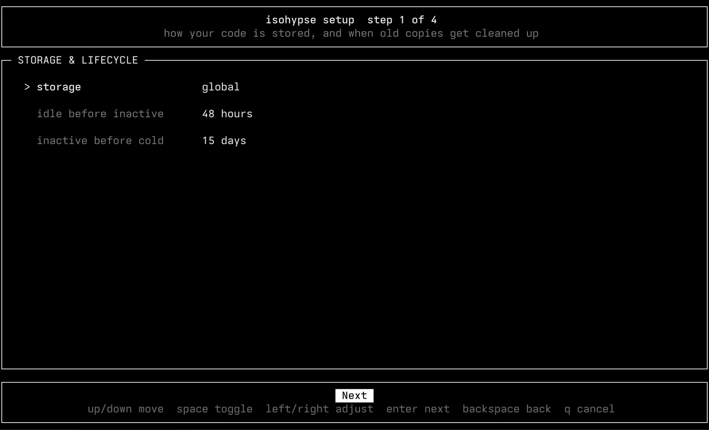
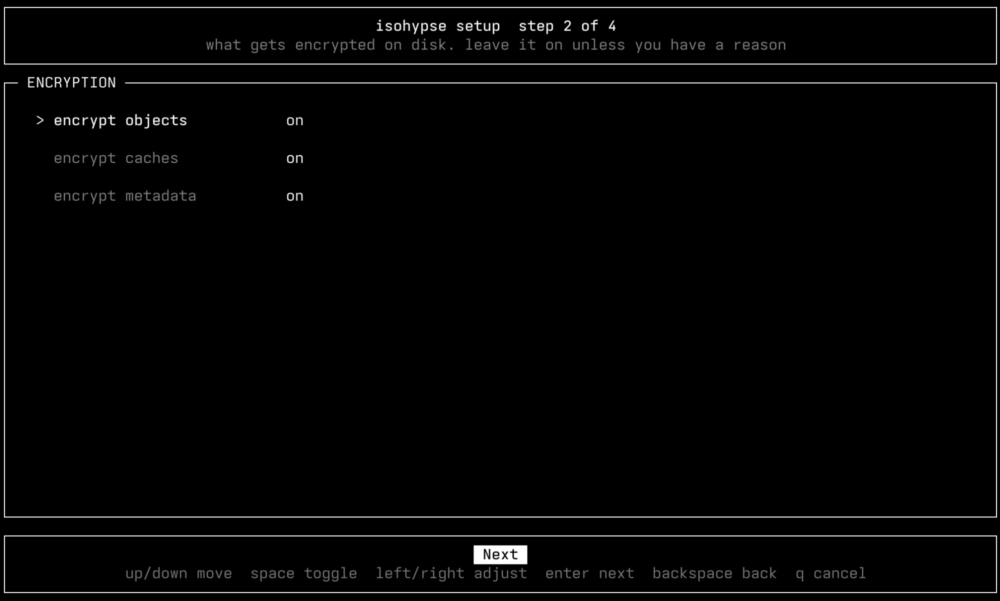
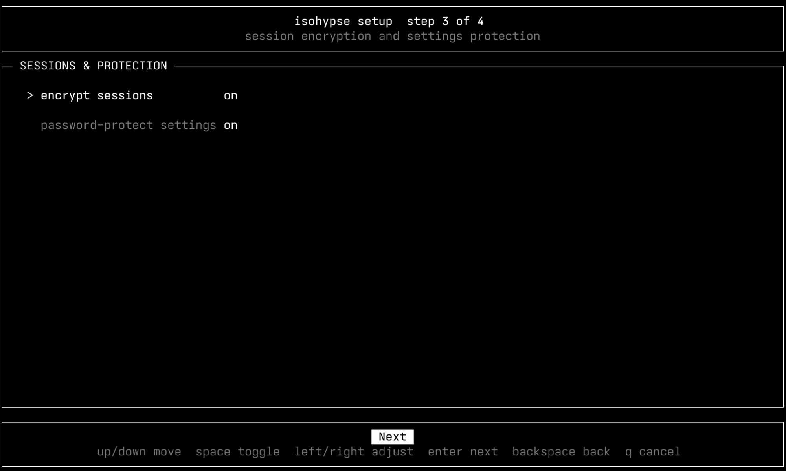
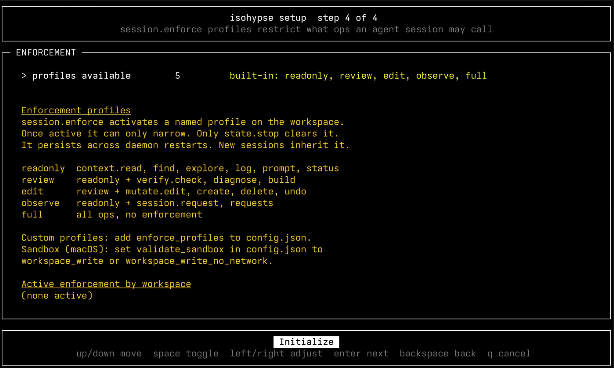

# Isohypse

Strip away the IDE, the language server, the linter, the formatter, and what you're left with is what programming actually is: read the code, understand what it touches, edit it, prove the edit worked. Human tools don't enforce any connection between those steps, and they don't need to, because humans have eyes and memory beyond 132k tokens.

We've all watched a model one-shot a full CRUD app with a test suite, then somehow lose the ability to center a modal. It tries four times, patches the wrong line, matches the wrong string, corrupts its own context... then somehow decides to rewrite the entire file because that's apparently easier than changing six lines. What is funny here, is that the model knew what to do on the first try, it just doesn't have the tools to do it right the first time.

Think of Isohypse as a environment that enforce "If you haven't read it, you cannot edit it." at the tooling level. As with most things in the Agent age, tracking things is difficult - who touched what, when and where. Git can only go so far. With Isohypse, you can reconstruct files from tool calls that were made against them, track changes that were made against files via tools in this environment, and hopefully solve the hairpulling moments of "Why did you touch that?!" we all encounter using Agents to build.

It goes without saying that this tooling environment would be ridiculously underutilized if used by a human - Isohypse, from its inception, is Agent tooling designed to be used by Agents. As backwards as it may sound, Agent-First tooling seems to work much better than handing them tools that humans designed for other humans to use.

One static Rust binary with no runtime, light on the memory.

Where grep and sed are hammers, Isohypse is a scalpel.

Give your Agents the tools they deserve, you've got tokens to burn on better things.

## Build

Requires Rust, macOS Command Line Tools, and [Task](https://taskfile.dev) (`brew install go-task`).

```bash
git clone https://github.com/redacktion/isohypse.git && cd isohypse
task setup
task install
```

`task setup` runs once per machine. It creates `~/bin`, then creates and trusts a local code-signing identity named `isohypse-local` in the login keychain. macOS asks for your password when trusting the certificate. Set `ISOHYPSE_CODESIGN_IDENTITY` to use a different identity.

`task install` builds the release binary, signs it with identifier `isohypse`, and moves it into `~/bin/isohypse`. Add `~/bin` to `PATH` if setup reports it missing. After the first install, `isohypse build` rebuilds, signs, and reloads a running workspace.

Other tasks: `task build`, `task verify`, `task check`, `task test`, `task clean`. Run `task` for the list.

## Setup

Run setup once before bringing a repository online:

```bash
isohypse setup
```

The setup TUI walks through storage mode, lifecycle cleanup, encryption categories, session handling, and agent protection. Review the defaults, adjust them to your liking, and save the configuration.



Choose global storage when several repositories or agents share one encrypted store. Choose micro storage when the repository must remain isolated.



Review lifecycle and encryption settings. These control when inactive workspace data is archived and which categories are encrypted.



Choose whether session records are encrypted and whether settings changes need your account password.



The last step lists the enforcement profiles and shows which workspaces have one active. See [Permissions per repository](#permissions-per-repository).




Finish setup, then start the current repository:

```bash
isohypse state up .
isohypse state status
```


Protected settings continue to use the authorization flow selected during setup.

## Agent Workflow

`isohypse call` and `isohypse hook` work with any agent that can run shell commands. The native adapters and Pi share one signed session transport, [harness/session.mjs](harness/session.mjs).

| Harness | Adapter | Notes |
| --- | --- | --- |
| Claude Code | [harness/claude/plugin](harness/shell/README.md#claude-code) | `isohypse call` through the Bash tool, plus hooks that brief the agent at session start and route Read, Grep, Glob, Edit, Write and equivalent shell commands. Any Claude Code version. |
| Codex | [harness/shell](harness/shell/README.md#codex-and-other-agents) | `isohypse call` through the shell tool, with an `AGENTS.md` instruction. Any Codex version. |
| Any shell-capable agent | [harness/shell](harness/shell/README.md) | The same two commands. |
| Claude Code, native tool | [harness/claude](harness/claude/README.md) | Optional. Registers a native `isohypse` tool in a verified Claude Code build. Version-pinned. |
| Codex, native tool | [harness/chatgpt/native](harness/chatgpt/native/README.md) | Optional. App-server extension in a pinned Codex build. |
| Pi | [harness/pi](harness/pi/README.md) | `pisohypse` extension through Pi's extension API. Workspace access and edit/validation execution require explicit approval. |

All adapters accept the same step fields: `label`, `arg`, `range`, `outline`, `paths`, `langs`, `max`, `literal`, `name`, `compact`, `full`, `tag`, `path`, `content`, `edits`, `checkpoint`. `context.log` and tagged `context.read` add saved-history fields.

Start each task by loading the grammar:

```bash
isohypse context prompt
```

Use exact reads, precise searches, and symbol exploration through one live session:

```bash
isohypse session --stdio
```

Send `session.open` first, then `session.command` frames with operations such as
`context.read`, `context.find`, and `context.explore`. Consume each matching
result before sending dependent work. `isohypse context prompt` documents the
wire format; these context operations are not standalone CLI subcommands.

## Operation grammar

[isohypse.schema_v0.3.md](isohypse.schema_v0.3.md) is the source of truth for the op surface, with the JSON Schema in [isohypse.schema_v0.3.json](isohypse.schema_v0.3.json). The served grammar (`isohypse context prompt`) is the model-facing summary.

- An op is one JSON object: `{"op":"<category>.<action>", ...}`. Categories: `context`, `mutate`, `verify`, `state`, `macro`, `session`.
- `label` is optional on every op. In a multi-op result it prints in the step header (`-- step N (op): label`).
- A multi-op containing any `mutate.*` step needs a top-level `validate`.
- `checkpoint: true` on a step runs the validation command after that step and rolls the whole batch back on failure.
- Related specs: [isohypse.tool.spec.md](isohypse.tool.spec.md), [isohypse.agent-runtime.spec.md](isohypse.agent-runtime.spec.md).

Every read produces a tag. Every edit must cite the tag it used. If the file changed, Isohypse stops or performs a constrained merge instead of overwriting newer content.

Native history calls reuse the existing journal and saved source store:
`context.log` lists revisions by recorded workspace, path, tag, or storage time;
`context.read` with `tag` retrieves a saved revision for review. Historical
reads retain edit tags and never restore live files. Read `context.prompt`
for filters, paging, and validation requirements.


Keep that session open for the investigation. Use `session.multiop` with an inline jq expression for ordered edits and validation.

## Search precision

The session operation `context.find` accepts one precise pattern; there is no `--any` mode.

Multiple patterns require a bounded `multi-op` or persistent `session` request with explicit paths, languages, pattern limits, and result limits. Broad exploration must use an explicit path, qualified symbol, or literal query.

## Atomic changes

`session.multiop` evaluates inline jq inside the daemon and executes the resulting steps as one transaction. Send this frame on an already-open session:

```json
{"do":"session.multiop","id":2,"expr":"{steps: [{label: \"read source\", op: \"context.read\", arg: $path}]}","bind":{"path":"src/lib.rs"}}
```

Named `bind` values become jq variables. For mutations, include the latest read
tag in the edit and a top-level validation command in the expression. Do not
send a prebuilt compound payload through `session.command`; use `expr`.

Mutations require a validation command or explicit `validate: "none"`. Failed transactions roll back prior mutations.

## Sessions, checkpoints, and streaming

Observer sessions (`observer: true`) accept only builtin readonly operations in
commands and evaluated multi-op steps. Validation fields, nested batches, macros,
and build operations are rejected before dispatch.

After three consecutive single-step read-only requests, a session result carries a one-time hint to send independent reads as one `steps` array.

A session keeps the operation stream open and lets an agent pipeline work without repeatedly starting the CLI. Multi-op and session results include compact checkpoints with completed operations, files and tags read or changed, validation results, and remaining work.

An explicit `session.close` drains accepted work before emitting the final
closed snapshot. Unexpected EOF without a close frame cancels outstanding work.
Use `session.cancel` for intentional cancellation. The CLI exits when the server
closes even if the input pipe remains open.

A shell-only ordered batch needs no Python response pump:

```bash
jq -nc --arg expr '{steps: [{op:"context.read",label:"inspect",arg:"src/main.rs",range:"1-80"}]}' '
  {do:"session.open",label:"inspection"},
  {do:"session.multiop",id:1,expr:$expr},
  {do:"session.close"}
' | isohypse session --stdio
```

Inspect the NDJSON result/error frames; the bridge exit status reports transport
errors, not individual operation failures.

Large reads can use NDJSON streaming. Chunks contain the path, tag, line range, sequence number, and text, followed by an EOF record. Use explicit ranges when only a small portion of a large file is needed.

## Errors

Failures identify whether the wrapper or Isohypse failed, the step and operation, the relevant path or tag, a replayable command, and current-versus-expected content. Read the error before retrying.

## Hot reload

`isohypse state reload` performs a signed, generation-aware handover. It reports the generation and executable path serving each workspace. The old process drains active work before retiring.

## Permissions per repository

Enforcement limits which ops agents may run in one repository. It attaches to the workspace (the repo root), so every session on that repo is bound by it, including sessions that start later. It survives daemon restarts.

### 1. Pick a profile

| Profile | Allowed ops | Use for |
| --- | --- | --- |
| `readonly` | `context.read`, `find`, `explore`, `log`, `prompt`, `state.status` | Agents that only look. |
| `review` | `readonly` + `verify.check`, `diagnose`, `build` | Agents that look and run checks. |
| `edit` | `review` + `mutate.edit`, `create`, `delete`, `undo` | Agents that change code. |
| `observe` | `readonly` + `session.request`, `requests` | Agents that watch other sessions. |
| `full` | All ops. No allowlist. | Default when nothing is set. |

### 2. Apply it to a repo

Start the daemon for the repo, then send `session.enforce` on a session in that directory:

```bash
cd path/to/repo
isohypse state up .
jq -nc '
  {do:"session.open",label:"admin"},
  {do:"session.enforce",enabled:true,profile:"review"},
  {do:"session.close"}
' | isohypse session --stdio
```

The reply carries `{"enforce":"review"}`. From then on, any op outside the profile returns an error:

```text
enforce: op "mutate.create" is not in the session allowlist; allowed: ["context.read", ...]
```

The setup TUI (step 4) lists the profiles and every workspace with active enforcement.

### 3. Change or clear it

- Enforcement only narrows. A new profile must be a subset of the active one. Widening returns `cannot widen permissions`. Disabling returns `cannot disable workspace enforcement`.
- Agents can call `session.enforce` too, so an agent can restrict itself and everyone else on the repo, never loosen.
- `isohypse state stop` clears enforcement for every workspace. It needs your account password and an interactive terminal.

### Custom profiles

Add profiles to `config.json` in the Isohypse store (`~/.isohypse/config.json`, or `$ISOHYPSE_STORE`):

```json
{
  "enforce_profiles": [
    {
      "name": "no-delete",
      "allowed": ["context.", "mutate.edit", "mutate.create", "verify."],
      "denied": ["mutate.delete"]
    }
  ]
}
```

- In `allowed`, `context.read` allows that one op. `context.` allows every op under `context`.
- In `denied`, `mutate` denies `mutate` and every op under it. `mutate.` denies the ops under `mutate` only.
- `denied` is checked first and wins over `allowed`.
- Patterns are non-empty without whitespace. A profile with an invalid pattern is refused when activated.
- An empty `allowed` list allows every op that `denied` does not block.
- Editing `config.json` by hand invalidates the signed store manifest. Run `isohypse setup --reenable-agent` and enter your account password to re-sign it.
- Activate the profile by name: `{"do":"session.enforce","enabled":true,"profile":"no-delete"}`.

### Other layers

- Observer sessions (`observer: true`) are read-only per session, independent of enforcement.
- Harness adapters carry their own write grant, separate from enforcement. Both must allow an edit.
- `validate_sandbox` confines validation commands. See [Validation sandbox](#validation-sandbox).

## Updates

Check release metadata without changing the installation:

```bash
isohypse update check
```

The command is read-only. It reports the installed version, latest release, and release notes URL. It never downloads or replaces a binary.

## Commands

Lifecycle commands remain CLI commands; agent operations use the session wire:

| Interface | Purpose |
| --- | --- |
| Session `context.read/find/explore` | Tagged reads, precise search, callers and impact. |
| Session `mutate.edit/create/delete/undo` | Tagged, anchored changes and recovery. |
| Session `verify.build/check/diagnose` | Build and validation. |
| Session frame `session.multiop` | Atomic inline-jq operation sequence. |
| CLI `state up/status/reload/down` | Workspace lifecycle and live state. |
| CLI `session --stdio` | Persistent NDJSON command stream. |
| CLI `call` | One batch in a fresh session, JSON on stdin. |
| CLI `hook` | Harness hook answer: workflow context at session start, and denial of built-in file tools and equivalent shell commands in favor of `call`. |
| CLI `context prompt` | Complete session grammar and examples. |
| CLI `setup` | TUI configuration. |
| CLI `update check` | Read-only release metadata check. |

`context` operations use the repository containing the current directory unless a workspace selector is supplied. Read-only operations can target a live workspace explicitly.

## Dependencies

The stack-graph crates come from crates.io: `isohypse-sg`, `isohypse-ts-sg`, `isohypse-tsg`, `isohypse-lsp-pos`, `isohypse-sg-py`, `isohypse-sg-js`, `isohypse-sg-ts`, `isohypse-sg-java`, and `isohypse-se`. Release history is in [CHANGELOG.md](CHANGELOG.md).

## Storage

Persistent state lives under the configured Isohypse store. Content-addressed objects deduplicate identical data and survive daemon restarts. Repository indexes are rebuilt from source; active session traces and lifecycle archives are retained according to the setup settings.

Store migrations run before serving a repository. The indexer skips common generated and dependency directories by default and accepts repository-specific exclusions through `.isohypseignore`.

## Validation sandbox

Applies to validation commands in `mutate.*` batches and `checkpoint` steps. `isohypse build` and `state reload` are not sandboxed.

Validation commands run with the daemon's OS privileges by default. On macOS, set `validate_sandbox` in `~/.isohypse/config.json` to confine them:

- `off`: no confinement (default).
- `workspace_write`: writes allowed under the workspace, temp dirs, `~/.cargo`, `~/.cache`, `~/.npm`. Reads and network unchanged.
- `workspace_write_no_network`: same, with all network access denied.

Other platforms refuse validation when the setting is not `off`.
